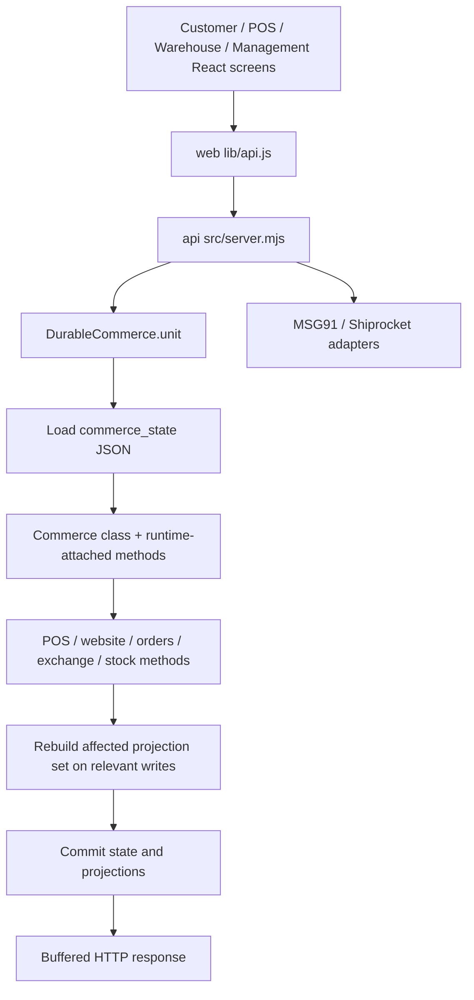

# TRENDISE code organisation review

19 November 2026 · source baseline bb1a390 · repository-wide structure review

## Assessment

The team’s difficulty locating features is justified. The repository has a recognisable frontend/backend split, but feature ownership and internal module boundaries need substantial improvement.

Several files own unrelated business processes. Some filenames conceal their actual responsibilities. Dense formatting makes otherwise modest files unusually difficult to read. The shared state and runtime method composition make a feature’s dependencies harder to discover through imports alone.

Earlier incremental development, including changes made in this chat, added working features without consistently correcting these structural problems. This review identifies where that happened and a sequence for correcting it safely.

This document reviews organisation and maintainability. Every first-party source file in the directories listed below was inventoried. Deep traces cover checkout, stock, POS billing/exchanges, warehouse fulfilment, catalogue approval, staff access, website settings and external adapters. It is not a line-by-line correctness certification of every feature.

## Review coverage and evidence

- 99 first-party source/configuration files inventoried across apps/api/src, apps/web/src, shared and scripts. Together they contain 548,734 bytes.
- 16 API source files, 66 web source files, 12 shared files and 5 scripts.
- 15 customer/staff page entry files.
- Both SQL migrations and all 17 API test files included in the structure review.
- package.json files, runtime startup scripts, .gitignore and current architecture/setup documents inspected.
- Generated Next.js output, dependencies, binary media, private environment values and database contents excluded from the source review.
- Existing regression suite rerun against an isolated local PostgreSQL schema. All 74 tests passed, with zero failures or skipped tests.
- This review made no application source changes. No new browser regression or production load test was performed.

Passing the existing tests provides a behaviour baseline for a later refactor. It does not establish that the code is easy to maintain.

## What is already in an appropriate place

The broad folder layout is useful.

- apps/web contains the Next.js UI.
- apps/api contains server execution, database access and integration adapters.
- shared contains several rules genuinely used on both sides.
- apps/api/migrations contains SQL schema setup.
- apps/api/tests contains automated business and HTTP/database tests.
- apps/web/public/media contains browser-served media.

A static import scan found no frontend import into apps/api/src. PostgreSQL access and provider credentials belong to server code. There is no evidence that database implementation has been copied into a customer React component.

Several existing shared modules should be retained, including size-chart.mjs, warehouse-pick.mjs, website-charges.mjs, split-payment.mjs and staff-access.mjs. Reusing AdminWorkspace for both management portals is also reasonable. Their authorisation can remain different while sharing screen components.

## Findings by priority

Priority reflects maintenance and change risk. A finding does not by itself mean a customer transaction currently fails.

### High — core.mjs is responsible for too many domains

apps/api/src/core.mjs contains 55 class methods across 555 lines and approximately 47.6 KB.

It owns catalogue lookup, barcode matching, mock OTP, staff sessions, checkout reservations, order creation, POS sale completion, inventory allocation, exchange selection/valuation, warehouse picking/dispatch, cancellations, exchange receipt, product validation and approval, categories, staff roles/users and stock receipts.

Examples include staffLogin, reserveCheckout, completePosSale, exchangeChoices, warehouseVerify, decideDraft and saveRole in the same class. A developer changing catalogue approval must inspect an object that also controls checkout and warehouse stock.

The file ends by attaching methods from website.mjs, pos.mjs, admin-orders.mjs, return-inspection.mjs and warehouse-inventory.mjs to Commerce.prototype. Dependencies between those methods are expressed through this, so imports alone do not reveal them.

Recommended correction — extract feature services with explicit dependencies and retain Commerce temporarily as a compatibility facade for current callers and tests. Move one feature at a time. Inventory and transaction context must stay shared during extraction.

Evidence in [core.mjs](../../apps/api/src/core.mjs), especially the constructor, domain methods and final Object.assign.

### High — routing, application orchestration and runtime startup share server.mjs

apps/api/src/server.mjs contains 62 literal GET/POST route checks and 14 path.match expressions. It also handles JSON parsing, CORS, token extraction, media responses, provider construction, transaction wrapping, webhook processing, error mapping and server startup.

Some routes delegate to a service, while others directly read or mutate the commerce object. For example, the Shiprocket export route locates an order, calls the provider and assigns shipment data itself. Website, access and inventory GET handlers directly assemble response objects.

Recommended correction — keep a small server entry point, one transport/error/transaction layer, and route modules for auth, catalogue, checkout, orders/exchanges, POS, warehouse, website settings and shipping. A route should validate transport input, authorise, call the relevant application operation and return its response.

Evidence in [server.mjs](../../apps/api/src/server.mjs).

### High — the PostgreSQL write path has an application-wide transaction boundary

database.mjs loads the complete commerce_state JSON document and write-locks its single row. database-projections.mjs deletes and rebuilds derived business tables when relevant state changes. These tables contain constraints, but request handlers generally operate on the in-memory aggregate loaded from the snapshot.

This explains why adding an isolated SQL table or editing a projection manually would not necessarily change application behaviour. A new developer needs to know which representation is authoritative.

The current write lock protects shared operations from simultaneous changes. However, writes for unrelated customers, products and stores share that lock. Rebuilding tables introduces work that grows with the entire dataset. No throughput limit has been measured in this review.

Recommended correction — document this as the present persistence design immediately. Treat moving to repositories and targeted SQL writes as a separate, tested persistence project. Preserve transactions, reservations, stock protection and durable idempotency during that work.

Evidence in [database.mjs](../../apps/api/src/database.mjs), [database-projections.mjs](../../apps/api/src/database-projections.mjs) and [001_m02.sql](../../apps/api/migrations/001_m02.sql).

### High — large page components mix screen rendering with workflow orchestration

checkout/page.jsx manages login/OTP, address and PIN lookup, payment selection, price quotes, coupon/points input, terms acceptance, idempotent placement, error handling and confirmation rendering. Its 84 lines contain approximately 18.3 KB, including a 2,770-character line.

warehouse/page.jsx owns queue polling, selected-order loading, barcode verification, dispatch, delivery, cancellation receipt, exchange receipt/inspection and inventory navigation. It contains approximately 20.7 KB.

pos/page.jsx owns stock polling, scanner handling, cart state, bill calculations, customer entry, saving, receipts and tab selection. AdminWorkspace similarly owns tab navigation, data loading, product editor state, approvals, inventory and category actions.

These files belong in the web application, but their responsibilities should be divided within feature folders.

Recommended correction — leave page.jsx as route composition. Extract named feature components and hooks for each workflow. Keep server-side enforcement authoritative. For example, POS can have Register, ScanInput, CurrentBill, CustomerHistory and ExchangeWorkspace with useRegister and usePosInventory.

Evidence in [checkout/page.jsx](../../apps/web/src/app/checkout/page.jsx), [warehouse/page.jsx](../../apps/web/src/app/warehouse/page.jsx), [pos/page.jsx](../../apps/web/src/app/pos/page.jsx) and [AdminWorkspace.jsx](../../apps/web/src/app/admin/AdminWorkspace.jsx).

### High — formatting is a direct obstacle to navigation and review

Examples from this revision include the following.

- website.mjs contains approximately 16 KB in 66 lines. Its longest line is 1,460 characters.
- WebsiteAdmin.jsx contains approximately 15.7 KB in 54 lines.
- storefront.css contains approximately 52.4 KB in 51 lines.
- globals.css contains approximately 33.1 KB in 40 lines. One line contains 25,768 characters.
- The API source contains 39 lines longer than 300 characters. Web source contains 148.

Short state setters such as O, D, S, R and M acquire different meanings in different components. This adds lookup effort when tracing asynchronous actions.

Recommended correction — apply consistent formatting and descriptive names in a dedicated behaviour-preserving change. Use a separate commit from file moves and functional fixes so reviewers can distinguish them.

Evidence in [website.mjs](../../apps/api/src/website.mjs), [WebsiteAdmin.jsx](../../apps/web/src/components/WebsiteAdmin.jsx), [storefront.css](../../apps/web/src/app/storefront.css) and [globals.css](../../apps/web/src/app/globals.css).

### Medium — filenames do not reliably identify feature ownership

Website price calculation calls posPricing in pos.mjs. Website promotion and Excel import routes call posPromotionList, savePosPromotion and importPosPrices with an online boolean.

Cross-channel customer history and data extraction are also implemented in pos.mjs. A developer looking for website customer export would reasonably search the customer or reporting module.

On the frontend, PosHistory.jsx contains receipt rendering, bill item rendering, exchange entries, the exchange form, website order lists and customer search. AdminProductEditor.jsx also exports the product list and includes media checks and preview behaviour. WebsiteAdmin.jsx contains a generic recursive content editor, coupons, rewards, media upload and management tabs.

Recommended correction — give shared pricing a channel-aware name and module. Move customer history/extraction into customers/reporting. Split PosReceipt, PosExchange and WebsiteOrderList into files whose names match the feature. Retain genuinely shared components through explicit imports.

Evidence in [pos.mjs](../../apps/api/src/pos.mjs), [PosHistory.jsx](../../apps/web/src/components/PosHistory.jsx), [AdminProductEditor.jsx](../../apps/web/src/components/AdminProductEditor.jsx) and [WebsiteAdmin.jsx](../../apps/web/src/components/WebsiteAdmin.jsx).

### Medium — website.mjs combines content, customer identity, promotions, rewards and media

The same method collection publishes website content, validates settings, saves customer contact details, handles coupons, updates birthdays/points, calculates online quotes, records reward usage and validates/stores uploaded media.

These processes have different inputs, permissions and lifecycle rules. Keeping them together increases the amount of code a developer must understand for a single change.

Recommended correction — separate website content/contact, customer profiles, promotions, rewards, quote composition and media storage. Preserve existing API response shapes during extraction.

Evidence in [website.mjs](../../apps/api/src/website.mjs).

### Medium — pricing and stock presentation need explicit boundaries

POS totals and included GST are calculated in pos/page.jsx, while posQuote in the backend recalculates them for saving. Website coupon previews use product-offer.mjs, while actual coupon and loyalty eligibility is enforced by onlineQuote.

Client calculations are useful for immediate display, and backend recalculation is necessary. The maintenance problem is that their roles and shared rounding rules are not obvious from placement.

Inventory availability appears in Commerce.available, centralBalances, warehouseInventory, API responses, and web availability hooks. Their calculations must continue to agree for inactive variants, reservations and central stock.

Recommended correction — document preview versus authoritative calculations. Centralise pure rounding/tax primitives where appropriate, while keeping database-backed availability and authorisation on the server. Prefer explicit quote operations and contract tests across channels.

Evidence in [pos/page.jsx](../../apps/web/src/app/pos/page.jsx), [pos.mjs](../../apps/api/src/pos.mjs), [website.mjs](../../apps/api/src/website.mjs), [core.mjs](../../apps/api/src/core.mjs), [warehouse-inventory.mjs](../../apps/api/src/warehouse-inventory.mjs) and [useCatalogAvailability.js](../../apps/web/src/lib/useCatalogAvailability.js).

### Medium — the frontend component and stylesheet organisation is too broad

A flat components directory contains storefront, staff authentication, POS, warehouse, reporting, product editing and website management components.

Chrome.jsx contains both the customer shell and operations shell. Global CSS includes selectors for several applications. PosHistory imports register.css from a route folder even though Admin also uses PosHistory.

This makes it difficult to tell whether a style/component change affects one screen or several applications.

Recommended correction — put feature-specific components and styles with their feature. Keep neutral controls, dialogs and feedback in shared UI. Give the customer and staff shells explicit names. Route/layout folders should compose them.

Evidence in [Chrome.jsx](../../apps/web/src/components/Chrome.jsx), [PosHistory.jsx](../../apps/web/src/components/PosHistory.jsx), [globals.css](../../apps/web/src/app/globals.css) and [storefront.css](../../apps/web/src/app/storefront.css).

### Medium — framework boundaries are present, but contracts are mostly implicit

HTTP routes, React callers and service methods agree through handwritten object shapes. There is no dedicated API contract/schema directory. DomainError is reusable, and there are several good shared validators, but other validation lives inline in routes, services and forms.

The generic browser api helper also groups fetch failures and JSON parsing failures into the same connection-error message. That can send someone toward restarting the server when the underlying issue is an invalid response.

Recommended correction — define request/response schemas or documented JSDoc types per feature and keep runtime validation on server entry points. Improve error classification separately. A framework rewrite or wholesale TypeScript conversion is not required for the first cleanup.

Evidence in [api.js](../../apps/web/src/lib/api.js), [server.mjs](../../apps/api/src/server.mjs), [errors.mjs](../../apps/api/src/errors.mjs) and existing shared validators.

### Medium — external side effects and database transactions need a clearer integration boundary

The Shiprocket order export performs a network request while the durable request transaction is open, then stores the provider result. If a remote operation succeeds and the local commit fails, the local rollback cannot undo the remote order. The existing error message asks operators to check the reference before retrying, which already acknowledges ambiguity.

Provider adapters are separated into shiprocket.mjs and customer-otp.mjs, which is useful. Their orchestration and deployment mode information remain spread across server.mjs, core.health, startup scripts and provider-specific environment settings.

Recommended correction — isolate adapter calls from transaction duration using a durable operation record and reconciliation/idempotency design. Consolidate environment/provider configuration into one documented server module. Preserve authorised live integrations and mock behaviour throughout the work.

Evidence in [server.mjs](../../apps/api/src/server.mjs), [shiprocket.mjs](../../apps/api/src/shiprocket.mjs), [customer-otp.mjs](../../apps/api/src/customer-otp.mjs), [core.mjs](../../apps/api/src/core.mjs) and [start-shiprocket-uat.zsh](../../scripts/start-shiprocket-uat.zsh).

### Medium — domain constants and migration rules are coupled to development fixtures

Runtime inventory, projections and exchange handling import centralWarehouseId from seed.mjs. Commerce constructs the demo catalogue, default staff and mock balances before DurableCommerce reloads persisted state.

restore also upgrades policy documents, size charts, central stock balances and active allocations during loading. The persistence wrapper saves those changes on a later successful write.

Recommended correction — move runtime constants/configuration out of fixtures and make schema/state upgrades discoverable as versioned migration steps. Maintain restart tests, once-only balance merging and historical record compatibility.

Evidence in [seed.mjs](../../apps/api/src/seed.mjs), [database.mjs](../../apps/api/src/database.mjs) and [core.mjs](../../apps/api/src/core.mjs).

### Medium — terminology and documentation make the current workflow harder to discover

Current exchanges still use return URLs, returnRequests and filenames such as return-inspection.mjs. That can be appropriate for compatibility, but the mapping is not collected in one current developer guide.

ARCHITECTURE.md still describes every durable read taking a row lock, although most GET requests now run as read-only snapshots. It describes transfers and absent external providers while current code has central-only stock operations and configurable Shiprocket/MSG91 adapters. Its staff-session and custom-role descriptions also lag the source.

PRE_UAT_REGRESSION_REPORT.md is a historical report with 49 tests and an earlier exchange lifecycle. It should remain historical and be linked with a clear date/status, rather than treated as current evidence.

Recommended correction — maintain one current feature-to-file/API map and current architecture document. Preserve historical reports with their original dates. Document return-to-exchange compatibility explicitly before renaming persisted fields or public endpoints.

Evidence in [ARCHITECTURE.md](../../ARCHITECTURE.md), [PRE_UAT_REGRESSION_REPORT.md](../../PRE_UAT_REGRESSION_REPORT.md), [order-policy.mjs](../../shared/order-policy.mjs), [server.mjs](../../apps/api/src/server.mjs) and [return-inspection.mjs](../../apps/api/src/return-inspection.mjs).

## Current feature map for the team

Use these starting points when navigating the present implementation.

- Customer shell and menus — Chrome.jsx with SiteProvider.jsx.
- Home and campaign films — app/page.jsx, CinemaHero.jsx, shared/hero-films.mjs.
- Collection and product screens — app/shop/page.jsx and app/product/[slug]/page.jsx, ProductCard.jsx, ProductPrice.jsx, catalog-media.js.
- Fit/size — SizeChart.jsx, size-guide.css, SizeChartEditor.jsx and shared/size-chart.mjs.
- Customer login — account/page.jsx and checkout/page.jsx, msg91-widget.js, server.mjs authentication routes, customer-otp.mjs and core session methods.
- Checkout — checkout/page.jsx, CartProvider.jsx, core reserveCheckout/finishCheckout/placeOrder, website onlineQuote.
- Coupons, birthdays and loyalty — WebsiteAdmin.jsx, account/page.jsx, website.mjs and shared/product-offer.mjs.
- About and customer contact — about/page.jsx, CustomerContact.jsx, CustomerContactSettings.jsx, website customerContact/saveCustomerContact and shared/customer-contact.mjs.
- Customer orders and exchanges — orders/page.jsx, OrderActions.jsx, ReturnOutcome.jsx, core requestOrderReturn/exchangeChoices/exchangeQuote and return-inspection.mjs.
- POS register — pos/page.jsx, core completePosSale and pos posQuote.
- POS exchange — PosHistory.jsx PosExchange, pos returnPosItem and core exchange rules.
- Receipts and POS terms — PosHistory.jsx PosReceipt, PosTerms.jsx and pos.mjs.
- Warehouse queue, verification and fulfilment — warehouse/page.jsx, core warehouse methods, PickBarcode.jsx and shared/warehouse-pick.mjs.
- Warehouse stock display — WarehouseInventory.jsx, warehouse-inventory.mjs and core available.
- Admin and Super Admin screens — admin/AdminWorkspace.jsx, admin/page.jsx, superadmin/page.jsx, StaffPortal.jsx and shared/staff-access.mjs.
- Product editing, approval and opening stock — AdminProductEditor.jsx, AdminWorkspace.jsx and core catalogue/draft methods.
- Categories and later stock receipts — AdminWorkspace.jsx and core addCatalogCategory/updateCatalogCategory/receiveStock.
- Customer lookup and Excel extracts — PosHistory.jsx, CustomerExtract.jsx, customer-history-export.mjs and pos purchaseHistory/purchaseExtract.
- Website and POS automatic price rules/imports — PosPromotions.jsx and pos promotion/import methods, selected by channel.
- Shipping — ShippingRates.jsx, ShipmentTracking.jsx, shiprocket.mjs, shipment-events.mjs and server routes.
- PostgreSQL — database.mjs, database-projections.mjs and migrations/001_m02.sql plus 002_website.sql.

## Current request and persistence flow



The provider branch varies by endpoint. Rate lookup is deliberately outside the main durable write wrapper, while shipment creation runs inside the durable request transaction. The diagram does not imply that PostgreSQL can roll back external provider actions.

## Recommended target structure

This is a proposed destination for review. No files have been moved.

```text
apps/
  web/src/
    app/                         Route and layout composition
    features/
      customer/
        storefront/
        authentication/
        checkout/
        orders/
        exchanges/
        account/
        about/
      pos/
        register/
        exchanges/
        receipts/
        reporting/
      warehouse/
        picking/
        dispatch/
        exchanges/
        inventory/
      management/
        dashboard/
        catalog/
        approvals/
        customers/
        website/
        staff/
    components/ui/               Neutral controls, dialogs, feedback
    layouts/                     CustomerShell and StaffShell
    lib/                         Browser HTTP and media helpers
  api/src/
    server.mjs                   Runtime composition and listen
    config/                      Runtime/provider/domain configuration
    http/                        Routing, validation, error responses
    modules/
      auth/
      catalog/
      inventory/
      checkout/
      orders/
      exchanges/
      pos/
      customers/
      promotions/
      rewards/
      website/
      reporting/
      shipping/
    integrations/                Shiprocket and MSG91 adapters
    persistence/                 Transactions, repositories, state upgrades
    fixtures/                    Mock catalogue and test/demo data
  api/tests/                     Existing tests retained during migration
shared/
  contracts/                     Deliberate browser/server data contracts
  rules/                         Pure calculations and policy/measurement rules
docs/
  architecture/
  workflows/
  reviews/
```

Within a feature, introduce files only when they clarify a real responsibility. Small features can remain a single module. Avoid creating a controller, service, repository and mapper mechanically for every screen.

## Suggested implementation sequence and acceptance checks

1. Establish the existing behaviour baseline and agree the feature ownership map. Record the current API paths and persisted field shapes.
2. Apply readable formatting and descriptive local names. Keep this change separate from logic and file moves.
3. Extract frontend features behind existing routes. Start with POS exchange/receipt/history, then checkout, warehouse and management sections.
4. Extract server route groups and feature operations behind the existing Commerce facade. Move shared pricing and customer reporting out of POS naming.
5. Consolidate request/response contracts, monetary primitives and authoritative stock calculations. Add focused tests where duplication could regress.
6. Correct current architecture/setup documentation and provide a single feature index with owners.
7. Plan the SQL repository transition separately, with an approved migration, backup and rollback approach.
8. Isolate/reconcile remote provider operations before describing the integrations as ready for unrestricted production transactions.

At each extraction boundary verify the following.

- The existing URL and permission rules still reach the same operation.
- Saved products, barcodes, orders, bills, policies and exchange records remain readable.
- Online holds and simultaneous POS/website sales cannot oversell shared stock.
- Retried bill, payment, receipt and exchange submissions remain idempotent.
- Draft edits remain private until the applicable publication action.
- Existing adapters keep the configured mock/live behaviour.
- Relevant tests pass, and the extracted UI is checked through its actual browser entry point.
- Each commit contains one reviewable extraction or behaviour change.

## Decisions to preserve during cleanup

- One central stock pool shared by website and POS.
- Existing staff-assigned store identifiers for historical bills and register assignment.
- Server-side role and permission enforcement.
- Distinct channel pricing and reporting, even where calculation helpers are shared.
- Existing external barcode values and stable SKU identity.
- Historical policy documents, cancellation receipts and earlier return/refund records.
- Shared management components where their permissions and capabilities are explicit.
- Development/test code with active callers.

The old garment overlay components are still imported by AdminProductEditor, even though customer try-on is hidden. ProductVisual is also still used by that preview. Neither can be labelled dead code solely because it is absent from the customer product page. Removal needs caller review and a business decision.

## Completion status

This review supports a staged structural refactor. It does not recommend a wholesale replacement of the greenfield application.

The immediate finding is that feature code is discoverable only after following several broad modules and indirect method dependencies. Improving formatting, feature folders, route ownership and the current developer map should precede further feature growth. Persistence and provider transaction changes require their own behaviour-focused work.

## Source inventory

Every file below was included in the organisation inventory. Counts describe this reviewed revision and exclude dependencies, media and generated build output.

### apps/api/src

- [apps/api/src/admin-dashboard.mjs](../../apps/api/src/admin-dashboard.mjs) — 50 lines, 3,132 bytes.
- [apps/api/src/admin-orders.mjs](../../apps/api/src/admin-orders.mjs) — 50 lines, 3,021 bytes.
- [apps/api/src/core.mjs](../../apps/api/src/core.mjs) — 555 lines, 47,568 bytes.
- [apps/api/src/customer-otp.mjs](../../apps/api/src/customer-otp.mjs) — 180 lines, 7,807 bytes.
- [apps/api/src/database-projections.mjs](../../apps/api/src/database-projections.mjs) — 95 lines, 3,814 bytes.
- [apps/api/src/database.mjs](../../apps/api/src/database.mjs) — 157 lines, 6,484 bytes.
- [apps/api/src/errors.mjs](../../apps/api/src/errors.mjs) — 3 lines, 152 bytes.
- [apps/api/src/pin-directory.mjs](../../apps/api/src/pin-directory.mjs) — 12 lines, 426 bytes.
- [apps/api/src/pos.mjs](../../apps/api/src/pos.mjs) — 305 lines, 18,213 bytes.
- [apps/api/src/return-inspection.mjs](../../apps/api/src/return-inspection.mjs) — 72 lines, 4,289 bytes.
- [apps/api/src/seed.mjs](../../apps/api/src/seed.mjs) — 37 lines, 4,411 bytes.
- [apps/api/src/server.mjs](../../apps/api/src/server.mjs) — 213 lines, 19,190 bytes.
- [apps/api/src/shipment-events.mjs](../../apps/api/src/shipment-events.mjs) — 50 lines, 2,866 bytes.
- [apps/api/src/shiprocket.mjs](../../apps/api/src/shiprocket.mjs) — 98 lines, 5,922 bytes.
- [apps/api/src/warehouse-inventory.mjs](../../apps/api/src/warehouse-inventory.mjs) — 44 lines, 2,561 bytes.
- [apps/api/src/website.mjs](../../apps/api/src/website.mjs) — 66 lines, 16,044 bytes.

### apps/web/src

- [apps/web/src/app/about/about.css](../../apps/web/src/app/about/about.css) — 24 lines, 2,517 bytes.
- [apps/web/src/app/about/page.jsx](../../apps/web/src/app/about/page.jsx) — 48 lines, 3,391 bytes.
- [apps/web/src/app/account/page.jsx](../../apps/web/src/app/account/page.jsx) — 18 lines, 6,760 bytes.
- [apps/web/src/app/admin/AdminWorkspace.jsx](../../apps/web/src/app/admin/AdminWorkspace.jsx) — 206 lines, 14,855 bytes.
- [apps/web/src/app/admin/page.jsx](../../apps/web/src/app/admin/page.jsx) — 6 lines, 213 bytes.
- [apps/web/src/app/cart/page.jsx](../../apps/web/src/app/cart/page.jsx) — 9 lines, 2,586 bytes.
- [apps/web/src/app/checkout/page.jsx](../../apps/web/src/app/checkout/page.jsx) — 84 lines, 18,317 bytes.
- [apps/web/src/app/globals.css](../../apps/web/src/app/globals.css) — 40 lines, 33,068 bytes.
- [apps/web/src/app/layout.jsx](../../apps/web/src/app/layout.jsx) — 8 lines, 687 bytes.
- [apps/web/src/app/login/page.jsx](../../apps/web/src/app/login/page.jsx) — 16 lines, 602 bytes.
- [apps/web/src/app/operations/page.jsx](../../apps/web/src/app/operations/page.jsx) — 5 lines, 109 bytes.
- [apps/web/src/app/operations.css](../../apps/web/src/app/operations.css) — 202 lines, 5,846 bytes.
- [apps/web/src/app/orders/page.jsx](../../apps/web/src/app/orders/page.jsx) — 15 lines, 3,787 bytes.
- [apps/web/src/app/page.jsx](../../apps/web/src/app/page.jsx) — 23 lines, 4,821 bytes.
- [apps/web/src/app/pos/page.jsx](../../apps/web/src/app/pos/page.jsx) — 207 lines, 14,444 bytes.
- [apps/web/src/app/pos/register.css](../../apps/web/src/app/pos/register.css) — 26 lines, 1,481 bytes.
- [apps/web/src/app/product/[slug]/page.jsx](../../apps/web/src/app/product/[slug]/page.jsx) — 31 lines, 7,987 bytes.
- [apps/web/src/app/shop/page.jsx](../../apps/web/src/app/shop/page.jsx) — 23 lines, 4,985 bytes.
- [apps/web/src/app/storefront.css](../../apps/web/src/app/storefront.css) — 51 lines, 52,422 bytes.
- [apps/web/src/app/superadmin/page.jsx](../../apps/web/src/app/superadmin/page.jsx) — 7 lines, 273 bytes.
- [apps/web/src/app/terms/page.jsx](../../apps/web/src/app/terms/page.jsx) — 10 lines, 622 bytes.
- [apps/web/src/app/warehouse/page.jsx](../../apps/web/src/app/warehouse/page.jsx) — 237 lines, 20,726 bytes.
- [apps/web/src/components/ActionFeedback.jsx](../../apps/web/src/components/ActionFeedback.jsx) — 6 lines, 397 bytes.
- [apps/web/src/components/AdminDashboard.jsx](../../apps/web/src/components/AdminDashboard.jsx) — 46 lines, 5,471 bytes.
- [apps/web/src/components/AdminOrders.jsx](../../apps/web/src/components/AdminOrders.jsx) — 95 lines, 9,168 bytes.
- [apps/web/src/components/AdminProductEditor.jsx](../../apps/web/src/components/AdminProductEditor.jsx) — 172 lines, 12,187 bytes.
- [apps/web/src/components/CancellationReturn.jsx](../../apps/web/src/components/CancellationReturn.jsx) — 13 lines, 1,027 bytes.
- [apps/web/src/components/CartProvider.jsx](../../apps/web/src/components/CartProvider.jsx) — 25 lines, 1,846 bytes.
- [apps/web/src/components/Chrome.jsx](../../apps/web/src/components/Chrome.jsx) — 15 lines, 5,442 bytes.
- [apps/web/src/components/CinemaHero.jsx](../../apps/web/src/components/CinemaHero.jsx) — 17 lines, 2,964 bytes.
- [apps/web/src/components/CustomerContact.jsx](../../apps/web/src/components/CustomerContact.jsx) — 12 lines, 502 bytes.
- [apps/web/src/components/CustomerContactSettings.jsx](../../apps/web/src/components/CustomerContactSettings.jsx) — 31 lines, 2,002 bytes.
- [apps/web/src/components/CustomerExtract.jsx](../../apps/web/src/components/CustomerExtract.jsx) — 57 lines, 3,102 bytes.
- [apps/web/src/components/DemoPaymentDetails.jsx](../../apps/web/src/components/DemoPaymentDetails.jsx) — 25 lines, 1,852 bytes.
- [apps/web/src/components/LocalStylePreview.jsx](../../apps/web/src/components/LocalStylePreview.jsx) — 21 lines, 9,055 bytes.
- [apps/web/src/components/OfferPrice.jsx](../../apps/web/src/components/OfferPrice.jsx) — 7 lines, 761 bytes.
- [apps/web/src/components/OrderActions.jsx](../../apps/web/src/components/OrderActions.jsx) — 40 lines, 7,819 bytes.
- [apps/web/src/components/OrderCharges.jsx](../../apps/web/src/components/OrderCharges.jsx) — 4 lines, 497 bytes.
- [apps/web/src/components/OrderTerms.jsx](../../apps/web/src/components/OrderTerms.jsx) — 4 lines, 674 bytes.
- [apps/web/src/components/PickBarcode.jsx](../../apps/web/src/components/PickBarcode.jsx) — 13 lines, 673 bytes.
- [apps/web/src/components/PosHistory.jsx](../../apps/web/src/components/PosHistory.jsx) — 155 lines, 12,625 bytes.
- [apps/web/src/components/PosPromotions.jsx](../../apps/web/src/components/PosPromotions.jsx) — 102 lines, 7,014 bytes.
- [apps/web/src/components/PosTerms.jsx](../../apps/web/src/components/PosTerms.jsx) — 40 lines, 1,981 bytes.
- [apps/web/src/components/ProductCard.jsx](../../apps/web/src/components/ProductCard.jsx) — 19 lines, 2,824 bytes.
- [apps/web/src/components/ProductPrice.jsx](../../apps/web/src/components/ProductPrice.jsx) — 12 lines, 1,153 bytes.
- [apps/web/src/components/ProductVisual.jsx](../../apps/web/src/components/ProductVisual.jsx) — 11 lines, 853 bytes.
- [apps/web/src/components/PurchaseChannel.jsx](../../apps/web/src/components/PurchaseChannel.jsx) — 8 lines, 438 bytes.
- [apps/web/src/components/ReturnOutcome.jsx](../../apps/web/src/components/ReturnOutcome.jsx) — 14 lines, 1,104 bytes.
- [apps/web/src/components/ShipmentTracking.jsx](../../apps/web/src/components/ShipmentTracking.jsx) — 13 lines, 1,047 bytes.
- [apps/web/src/components/ShippingRates.jsx](../../apps/web/src/components/ShippingRates.jsx) — 66 lines, 4,149 bytes.
- [apps/web/src/components/SiteProvider.jsx](../../apps/web/src/components/SiteProvider.jsx) — 15 lines, 1,704 bytes.
- [apps/web/src/components/SizeChart.jsx](../../apps/web/src/components/SizeChart.jsx) — 77 lines, 6,538 bytes.
- [apps/web/src/components/SizeChartEditor.jsx](../../apps/web/src/components/SizeChartEditor.jsx) — 9 lines, 3,261 bytes.
- [apps/web/src/components/StaffAccessEditor.jsx](../../apps/web/src/components/StaffAccessEditor.jsx) — 87 lines, 5,256 bytes.
- [apps/web/src/components/StaffPortal.jsx](../../apps/web/src/components/StaffPortal.jsx) — 88 lines, 3,881 bytes.
- [apps/web/src/components/StaffWorkspace.jsx](../../apps/web/src/components/StaffWorkspace.jsx) — 32 lines, 1,051 bytes.
- [apps/web/src/components/StoreDialog.jsx](../../apps/web/src/components/StoreDialog.jsx) — 7 lines, 1,290 bytes.
- [apps/web/src/components/StorePhoto.jsx](../../apps/web/src/components/StorePhoto.jsx) — 9 lines, 789 bytes.
- [apps/web/src/components/WarehouseInventory.jsx](../../apps/web/src/components/WarehouseInventory.jsx) — 59 lines, 5,222 bytes.
- [apps/web/src/components/WebsiteAdmin.jsx](../../apps/web/src/components/WebsiteAdmin.jsx) — 54 lines, 15,658 bytes.
- [apps/web/src/components/size-guide.css](../../apps/web/src/components/size-guide.css) — 43 lines, 4,205 bytes.
- [apps/web/src/lib/api.js](../../apps/web/src/lib/api.js) — 25 lines, 1,413 bytes.
- [apps/web/src/lib/catalog-media.js](../../apps/web/src/lib/catalog-media.js) — 37 lines, 2,937 bytes.
- [apps/web/src/lib/customer-history-export.mjs](../../apps/web/src/lib/customer-history-export.mjs) — 34 lines, 1,770 bytes.
- [apps/web/src/lib/msg91-widget.js](../../apps/web/src/lib/msg91-widget.js) — 31 lines, 1,116 bytes.
- [apps/web/src/lib/useCatalogAvailability.js](../../apps/web/src/lib/useCatalogAvailability.js) — 37 lines, 1,217 bytes.

### shared

- [shared/admin-orders.mjs](../../shared/admin-orders.mjs) — 11 lines, 998 bytes.
- [shared/customer-contact.mjs](../../shared/customer-contact.mjs) — 1 lines, 102 bytes.
- [shared/hero-films.mjs](../../shared/hero-films.mjs) — 17 lines, 1,257 bytes.
- [shared/order-policy.mjs](../../shared/order-policy.mjs) — 115 lines, 17,081 bytes.
- [shared/product-offer.mjs](../../shared/product-offer.mjs) — 13 lines, 642 bytes.
- [shared/size-chart.mjs](../../shared/size-chart.mjs) — 41 lines, 4,473 bytes.
- [shared/split-payment.mjs](../../shared/split-payment.mjs) — 17 lines, 855 bytes.
- [shared/staff-access.mjs](../../shared/staff-access.mjs) — 90 lines, 6,068 bytes.
- [shared/tryon-geometry.mjs](../../shared/tryon-geometry.mjs) — 11 lines, 1,359 bytes.
- [shared/warehouse-pick.mjs](../../shared/warehouse-pick.mjs) — 8 lines, 431 bytes.
- [shared/website-charges.mjs](../../shared/website-charges.mjs) — 15 lines, 582 bytes.
- [shared/website-defaults.json](../../shared/website-defaults.json) — 16 lines, 5,298 bytes.

### scripts

- [scripts/build-pin-directory.py](../../scripts/build-pin-directory.py) — 39 lines, 1,989 bytes.
- [scripts/db.mjs](../../scripts/db.mjs) — 2 lines, 336 bytes.
- [scripts/demo-delivered-order.mjs](../../scripts/demo-delivered-order.mjs) — 35 lines, 2,885 bytes.
- [scripts/dev.mjs](../../scripts/dev.mjs) — 9 lines, 511 bytes.
- [scripts/start-shiprocket-uat.zsh](../../scripts/start-shiprocket-uat.zsh) — 34 lines, 1,533 bytes.
